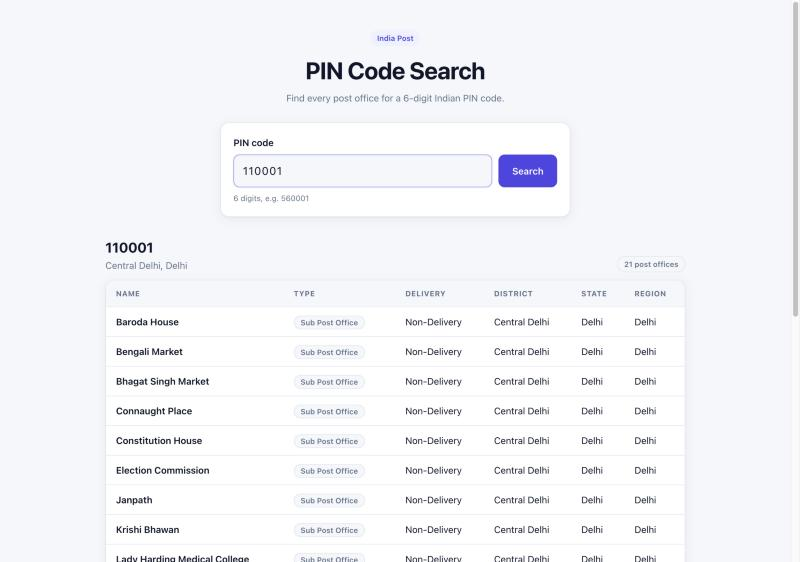
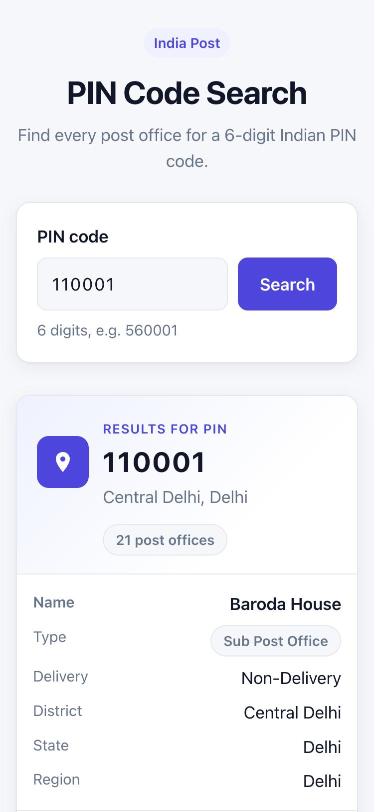

# Postal Code Check

## What is Postal Code Check?

Postal Code Check is a light, fast Angular application for looking up Indian
postal PIN codes. Enter any 6-digit PIN code and it lists every post office that
serves it, with branch type, delivery status, district, state and region.
Results come from the public [Postal PIN Code API](https://api.postalpincode.in).

It is built on the latest Angular, using standalone components, signals,
zoneless change detection and the new `@if` / `@for` control flow. The interface
is responsive (a table on desktop, stacked cards on mobile) and follows the
system light or dark theme.

The source code is hosted on [GitHub](https://github.com/gowthamand/postal-code-check).

## Screenshots

### Desktop



### Mobile



## Important Change with Angular 22

This project was upgraded from **Angular 12 to Angular 22**. Angular 12 no longer
builds on current Node.js releases (`ERR_OSSL_EVP_UNSUPPORTED`).

Notable changes:

- The build uses the `@angular/build:application` builder (esbuild + Vite) instead of webpack.
- `AppModule` was removed; the app starts with `bootstrapApplication()` and `provideHttpClient()`.
- `zone.js`, `polyfills.ts` and the `environments/` files were removed. The app is zoneless.
- Karma/Jasmine were replaced by **Vitest** with jsdom.
- **Node.js 22 or newer is now required** (see [Server Requirements](#server-requirements)).

If you are updating an existing checkout, delete `node_modules` and
`package-lock.json` before running `npm install` again.

## Installation & Updates

Clone the repository and install dependencies:

```bash
git clone git@github.com:gowthamand/postal-code-check.git
```

```bash
cd postal-code-check
```

```bash
nvm use
```

```bash
npm install
```

To get the latest changes, run `git pull` followed by `npm install`.

The repository includes an `.npmrc` with `legacy-peer-deps=true`. It works
around an npm 10 resolver bug (`Cannot read properties of null (reading 'edgesOut')`)
that Vitest's optional peer dependencies trigger.

## Setup

Start the development server:

```bash
npm start
```

Then open `http://localhost:4200/`. The app reloads automatically when you change a source file.

Build for production:

```bash
npm run build
```

The output is written to `dist/angular-postal-pin/browser/`. Deploy that folder
to any static web host.

### Deploying to Vercel

The repository includes a `vercel.json` with the build command, output directory
and a single-page-app rewrite. Import the repo in Vercel, or run:

```bash
npx vercel --prod
```

Vercel picks the Node.js version from `engines` in `package.json` (Node 22).

## Repository Management

Please use GitHub issues to report bugs or request features.

The `main` branch is the stable, deployable branch.

## Contributing

Contributions are welcome.

1. Fork the repository and create a feature branch.
2. Keep changes focused and follow the existing code style (standalone components, signals, typed services).
3. Add or update tests in `src/app/*.spec.ts`.
4. Make sure `npm run build` and `npm test` both pass.
5. Open a pull request against `main`.

## Server Requirements

Node.js **22.22.3** or higher is required (`^22.22.3 || ^24.15.0 || >=26.0.0`).
The project pins **22.23.2** in `.nvmrc`.

> [!WARNING]
> Node.js 20 and earlier are **not** supported by Angular 22.

You also need:

- npm 10 or newer
- A modern evergreen browser (Chrome, Edge, Firefox or Safari)
- Network access to `https://api.postalpincode.in` at runtime

Main dependencies:

| Package     | Version |
| ----------- | ------- |
| Angular     | 22.x    |
| TypeScript  | 6.0.x   |
| RxJS        | 7.8.x   |
| Vitest      | 4.x     |

## Running Postal Code Check Tests

Run the unit test suite once:

```bash
npm test -- --watch=false
```

Or run it in watch mode while developing:

```bash
npm test
```

The suite covers input cleanup, PIN validation, successful results, the
"no post offices found" state and API errors.

Last verified on Node.js 22.23.2:

| Check                   | Result                                    |
| ----------------------- | ----------------------------------------- |
| `npm run build`         | Passed, initial bundle about 202 kB (57 kB gzipped) |
| `npm test`              | 6 / 6 tests passed                        |
| Manual check (`560001`) | 10 Bangalore post offices listed          |
